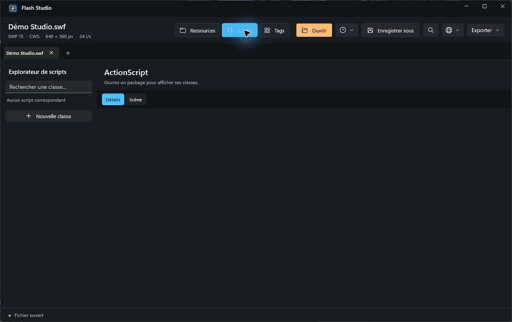

# Flash Studio

[English](README.md)

Flash Studio est un atelier Windows pour inspecter, modifier et exporter des fichiers SWF. Une même solution Visual Studio réunit le moteur SWF C++20, l’interface WinUI 3 et un outil en ligne de commande.



## Explorer et modifier

- Parcourez les ressources, les tags, les images de la timeline et les packages ActionScript imbriqués de plusieurs SWF dans des onglets distincts. La recherche couvre le source, le P-code, les textes, les constantes ABC et les noms de tags.
- Utilisez **Ouvrir un dossier** (`Ctrl+Maj+O`) pour indexer les SWF d’un dossier et de ses sous-dossiers. L’espace de travail liste leurs chemins relatifs et les ouvre à la sélection. Dans le code, un `Ctrl+clic` sur un chemin SWF entre guillemets ouvre le fichier local correspondant dans un onglet. Appuyez sur `F1` pour consulter les raccourcis.
- Lisez l’ActionScript coloré ou examinez les instructions AVM1 et AVM2 et les données brutes des tags. Dans le source décompilé, un `Ctrl+clic` sur un type résolu ouvre sa classe dans un onglet. Épinglez les classes à garder à gauche de la barre de scripts. Les onglets SWF occupent la barre de titre.
- Si Flash Studio reconnaît de l’ActionScript obfusqué, il propose de nettoyer le SWF à l’ouverture. Utilisez **Désobfusquer…** dans la barre des scripts pour une classe ou un bloc ABC, ou **Modifier ABC → Désobfusquer le SWF…** pour le fichier entier. L’étape facultative de simplification résout les appels aux décodeurs reconnus et raccourcit les identifiants obfusqués dans le document courant.
- Après le nettoyage, choisissez **Simplifier les chaînes** pour remplacer les appels aux décodeurs reconnus par leurs résultats littéraux. Flash Studio évalue les calculs pris en charge sans lancer le SWF.
- Dans **Scripts**, cliquez sur **Nouvelle classe** et saisissez un nom comme `demo.outils.Compteur`. Modifiez la classe générée dans le panneau ActionScript, puis cliquez sur **Appliquer** pour la compiler dans le SWF courant. Pour une classe existante, choisissez **Éditer le code**.
- Un astérisque signale les modifications en attente. Utilisez **Enregistrer** pour écrire dans le fichier courant ou **Enregistrer sous** pour choisir un autre chemin. Flash Studio demande quoi faire des modifications à la fermeture et rouvre les onglets laissés ouverts au démarrage suivant.
- Utilisez `Ctrl+Espace` pour compléter des noms locaux, des classes du SWF et des types de l’API Flash. Choisissez une classe pour ajouter l’import nécessaire. `Ctrl+S` lance la compilation. En cas d’erreur, le brouillon reste ouvert avec le diagnostic.
- Ouvrez le menu en forme de globe pour choisir **Français** ou **English**. Redémarrez l’application pour appliquer ce choix. Les options `--language fr` et `--language en` permettent de sélectionner la langue pour un seul lancement.

## Prévisualiser et exporter

- Sélectionnez une ressource **DefineShape**, puis **Éditer la forme**. Déplacez ou redimensionnez les éléments, retouchez les sommets et les poignées de courbe, modifiez les couleurs et les dégradés ou dessinez des rectangles, des ellipses, des lignes et des polygones. Cliquez sur **Appliquer au SWF** pour mettre à jour le document.
- Éditez les champs de texte et les textes statiques à un seul style avec des glyphes incorporés. Remplacez les images bitmap, les sons indépendants et les ressources binaires. Visualisez les tracés des glyphes et inspectez les données binaires en hexadécimal, avec les informations du SWF encapsulé lorsqu’il est reconnu.


Lisez, mettez en pause et parcourez les sprites à la cadence du SWF. Exportez les formes et les images de la timeline en SVG, PNG, BMP, JPEG ou TIFF. Les sprites animés s’exportent en GIF, APNG ou SVG animé, avec une échelle réglable, par exemple 400 %. Vous pouvez exporter une ressource, un lot de visuels ou un projet extrait contenant ActionScript, P-code, données brutes et médias.

Choisissez **Exporter → Exporter en HTML5** pour convertir la scène, la cadence d’origine, les effets visuels et les pistes audio prises en charge en un projet web statique. L’export génère du JavaScript pour les méthodes, scripts d’images et événements ActionScript pris en charge. Les références SWF explicites trouvées dans l’espace de travail sont converties en projets web liés. Lancez le serveur fourni avec `py -3 serve.py` ou publiez le dossier sur un hébergement statique. Consultez `LISEZ-MOI.txt` pour les effets, scripts et dépendances à porter manuellement. L’ActionScript récupéré se trouve dans `sources/`.

Pour convertir un site ou une bibliothèque entière, utilisez **Ouvrir un dossier**, puis **Exporter le dossier en HTML5** dans le panneau Espace de travail. Flash Studio parcourt les sous-dossiers et inclut les modifications des onglets ouverts dans l’espace de travail. L’export fournit une page d’entrée et un catalogue des animations. Le lecteur commun résout les chemins assemblés à l’exécution par ActionScript et charge les films convertis dans la même liste d’affichage. Publiez à la racine du site pour conserver les chemins absolus des ressources. Les jeux qui utilisent des services HTTP ou WebSocket ont toujours besoin de leur serveur. Les réglages de connexion locale se trouvent dans `__flashstudio/network.json`.

Le compilateur AS3 relie les classes de plusieurs blocs ABC et génère le JavaScript hors ligne dans `classes.js`. Il prend en charge l’héritage, `super`, les champs privés, l’initialisation statique et les objets auxiliaires. Les adaptateurs web couvrent des événements, les minuteries et le dessin vectoriel. Les diagnostics identifient les méthodes et API Flash qui restent à porter.

Le navigateur affiche les balises Flash prises en charge dans `htmlText` et gère les symboles de la timeline, l’ordre d’affichage, les messages locaux, les projets liés, les requêtes HTTP et l’audio. Dans `network.json`, associez les chemins HTTP d’origine à leurs nouvelles adresses sous `http` et les adresses `hôte:port` aux points d’accès WebSocket sous `sockets`. Pour un service TCP, associez le socket à `/__flashstudio_socket/chat` et renseignez `host` et `port` sous `tcp.chat`. Le pont fourni par `serve.py` écoute sur la boucle locale. Les services HTTP distants doivent autoriser l’origine de la page.

## Compiler sous Windows

Installez Visual Studio 2022 17.14 ou Visual Studio 2026 avec **Développement Desktop en C++** et le SDK Windows 10.0.26100. Ouvrez `FlashStudio.slnx`, choisissez **FlashStudio** comme projet de démarrage, puis sélectionnez **x64** ou **ARM64** avec les outils MSVC correspondants.

Depuis une Developer PowerShell for Visual Studio :

```powershell
msbuild FlashStudio.slnx -restore -m -p:Configuration=Release -p:Platform=x64
$app = ".\artifacts\bin\x64\Release\FlashStudio"
& "$app\FlashStudio.exe"
```

Conservez l’ensemble du dossier de sortie pour distribuer l’application. L’éditeur de code charge ses ressources localement et utilise le runtime Microsoft Edge WebView2.

### Activer la compilation ActionScript

Installez Java et téléchargez le compilateur et les définitions de l’API Flash dans le dossier de sortie :

```powershell
.\scripts\install-as3-tools.ps1 -ApplicationDirectory $app
```

L’application recherche `tools/as3/asc.jar` à côté de l’exécutable. Le compilateur charge les définitions de l’API Flash depuis `playerglobal.swc` dans le même dossier, ou les types de base ActionScript depuis `builtin.abc`. Une fois la configuration terminée, l’édition et la compilation fonctionnent hors ligne. [Archive du compilateur ActionScript](https://ftp.mozilla.org/pub/js/tamarin/builds/milestones/tamarin-central-01/) · [WebView2 pour WinUI 3](https://learn.microsoft.com/fr-fr/windows/apps/develop/ui/controls/webview2)

L’ajout de classes requiert un SWF ActionScript 3. L’édition de source prend en charge ABC 46.16 et conserve la superclasse, les interfaces et les modificateurs de la classe. Pour les méthodes dont le source ne peut pas être reconstruit, ouvrez **Instructions**.

## Ligne de commande

```powershell
$flash = ".\artifacts\bin\x64\Release\FlashTool\FlashTool.exe"
$asc = "$app\tools\as3\asc.jar"
& $flash info film.swf
& $flash search film.swf 'getServer\w+' --source --regex
& $flash class-new film.swf demo.outils.Compteur Compteur.as film-avec-compteur.swf $asc
& $flash class-edit film.swf 8 demo.Probe Probe.as film-modifie.swf $asc
& $flash sprite-animation film.swf 127 sprite.gif 4
& $flash export-project film.swf projet-extrait
& $flash export-html5 film.swf projet-html5
& $flash export-html5 site\chat\chat.swf chat-html5 site
```

Les indices de tags commencent à zéro. L’export HTML5 renvoie le code 3 quand le projet généré contient des points de portage. `FlashTool --help` affiche la liste des commandes.

## Vérifications

```powershell
python tests\smoke.py $flash --fixtures artifacts\smoke
python tests\smoke.py $flash --asc "$app\tools\as3" --fixtures artifacts\smoke-as3
node tests\editor-completion.mjs
```

Les tests AS3 couvrent la création de classes, les doublons, le source invalide et la recompilation. Le sprite de démonstration provient d’un SWF synthétique généré par les tests.
