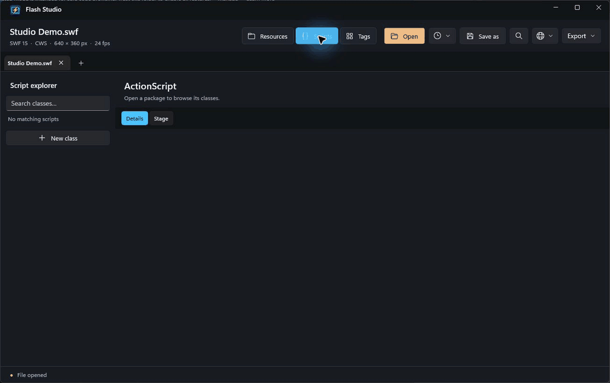

# Flash Studio

[Français](README.fr.md)

Flash Studio is a Windows workbench for inspecting, editing and exporting SWF files. It brings a C++20 SWF engine, a WinUI 3 interface and a command-line tool together in one Visual Studio solution.



## Explore and edit

- Browse the resources, tags, frames and nested ActionScript packages of multiple SWFs in separate tabs. Search source, P-code, text, ABC constants and tag names across a document.
- Use **Open folder** (`Ctrl+Shift+O`) to index the SWFs in a directory and its subdirectories. The workspace lists relative paths and opens each SWF when selected. In code, `Ctrl+click` a quoted SWF path to open the matching local file in a tab. Press `F1` to see the keyboard shortcuts.
- Read syntax-highlighted ActionScript or inspect AVM1 and AVM2 instructions and raw tag data. In decompiled source, `Ctrl+click` a resolved type to open its class in a tab. Pin classes to keep them on the left of the script tab strip. SWF tabs sit in the title bar.
- If Flash Studio recognizes obfuscated ActionScript, it offers to clean up the SWF when it opens. Use **Deobfuscate…** in the script toolbar for a selected class or ABC block, or **Edit ABC → Deobfuscate SWF…** for the whole document. The optional simplification step resolves calls to recognized decoders and shortens obfuscated identifiers in the current document.
- After cleanup, choose **Simplify strings** to replace calls to recognized string decoders with their literal results. Flash Studio evaluates the supported calculations without running the SWF.
- In **Scripts**, choose **New class** and enter a name such as `demo.tools.Counter`. Edit the generated class in the ActionScript pane, then select **Apply** to compile it into the current SWF. Use **Edit code** for an existing class.
- An asterisk marks tabs with unsaved changes. Use **Save** to write the current file or **Save as** to choose a new path. Flash Studio asks what to do with unsaved changes when you close a tab or quit and restores the tabs you left open on the next launch.
- Complete local names, SWF classes and Flash API types with `Ctrl+Space`. Select a class suggestion to add its import when needed. Use `Ctrl+S` to compile. Compiler diagnostics stay with the draft.
- Open the globe menu to choose **English** or **Français**. Restart the app to apply the saved preference. Use `--language en` or `--language fr` to override it for one launch.

## Preview and export

- Select a **DefineShape** resource and choose **Edit shape**. Move or resize elements, edit vertices and curve handles, change solid fills and gradients, or draw rectangles, ellipses, lines and polygons. Use **Apply to SWF** to update the document.
- Edit text fields and single-style static text with embedded glyphs. Replace bitmap images, individual sounds and binary resources. Preview embedded glyph outlines or inspect binary payloads in hexadecimal, including information about any recognized embedded SWF.


Play, pause and scrub sprite previews at the SWF's frame rate. Export shapes and frames as SVG, PNG, BMP, JPEG or TIFF. Export an animated sprite as GIF, APNG or animated SVG, with an optional output scale such as 400%. Export individual resources, visual batches or an extracted project containing ActionScript, P-code, raw tags and media.

Choose **Export → Export as HTML5** to convert the stage, original frame rate, visual effects and supported audio streams into a static web project. The export generates JavaScript for supported ActionScript methods, frame scripts and events. Literal SWF references found in the workspace are converted into linked web projects. Start the included local server with `py -3 serve.py` or publish the folder on a static host. Check `LISEZ-MOI.txt` for effects, scripts and dependencies that need manual porting. Recovered ActionScript is available in `sources/`.

To convert a whole site or library, use **Open folder** and then **Export folder as HTML5** in the Workspace pane. Flash Studio scans subfolders and includes edits from open workspace tabs. The output has an entry page and an animation catalogue. A shared runtime resolves paths assembled by ActionScript at run time and loads the converted movies into the same display list. Publish at the site root so that absolute resource URLs retain their original meaning. Games that use HTTP or WebSocket services still need their backend. Local connection settings are in `__flashstudio/network.json`.

The offline AS3 compiler links classes across ABC blocks and writes JavaScript to `classes.js`. It supports inheritance, `super`, private fields, static initialization and helper objects. Browser adapters cover supported events, timers and vector drawing. Conversion diagnostics identify methods and Flash APIs that still need porting.

The browser renders the supported Flash `htmlText` tags and handles timeline symbols, display-list ordering, local messages, linked projects, HTTP requests and audio. Use `network.json` to map original HTTP paths under `http` or original `host:port` values to WebSocket endpoints under `sockets`. For a raw TCP service, map the socket to `/__flashstudio_socket/chat` and set `tcp.chat` to an object with `host` and `port`. The bridge in `serve.py` listens on loopback. Remote HTTP services still need to allow the page's origin.

## Build on Windows

Install Visual Studio 2022 17.14 or Visual Studio 2026 with **Desktop development with C++** and Windows SDK 10.0.26100. Open `FlashStudio.slnx`, select **FlashStudio** as the startup project, and use **x64** or **ARM64** with the matching MSVC tools.

From a Visual Studio Developer PowerShell:

```powershell
msbuild FlashStudio.slnx -restore -m -p:Configuration=Release -p:Platform=x64
$app = ".\artifacts\bin\x64\Release\FlashStudio"
& "$app\FlashStudio.exe"
```

Keep the output directory together when distributing the app. The embedded code editor loads its assets locally and uses the Microsoft Edge WebView2 Runtime.

### Enable ActionScript compilation

Install Java and download the compiler and Flash API definitions into the output folder:

```powershell
.\scripts\install-as3-tools.ps1 -ApplicationDirectory $app
```

The app looks for `tools/as3/asc.jar` beside the executable. The compiler reads Flash API definitions from `playerglobal.swc` in the same folder, or `builtin.abc` for the core ActionScript types. After setup, editing and compilation work offline. [ActionScript Compiler archive](https://ftp.mozilla.org/pub/js/tamarin/builds/milestones/tamarin-central-01/) · [WebView2 for WinUI 3](https://learn.microsoft.com/en-us/windows/apps/develop/ui/controls/webview2)

New classes require an ActionScript 3 SWF. Source editing supports ABC 46.16 and preserves the class's superclass, interfaces and modifiers. Inspect **Instructions** for methods the decompiler cannot reconstruct as source.

## Command line

```powershell
$flash = ".\artifacts\bin\x64\Release\FlashTool\FlashTool.exe"
$asc = "$app\tools\as3\asc.jar"
& $flash info movie.swf
& $flash search movie.swf 'getServer\w+' --source --regex
& $flash class-new movie.swf demo.tools.Counter Counter.as movie-with-counter.swf $asc
& $flash class-edit movie.swf 8 demo.Probe Probe.as edited.swf $asc
& $flash sprite-animation movie.swf 127 sprite.gif 4
& $flash export-project movie.swf extracted
& $flash export-html5 movie.swf html5-project
& $flash export-html5 site\chat\chat.swf html5-chat site
```

Tag indices start at zero. HTML5 export returns code 3 when it generates a project with porting notes. Run `FlashTool --help` for the full command list.

## Checks

```powershell
python tests\smoke.py $flash --fixtures artifacts\smoke
python tests\smoke.py $flash --asc "$app\tools\as3" --fixtures artifacts\smoke-as3
node tests\editor-completion.mjs
```

The AS3 checks cover class creation, duplicate names, invalid source and recompilation. The sample animation uses a synthetic SWF generated by the smoke suite.
